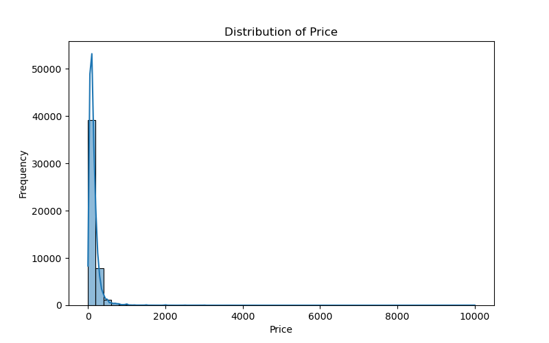
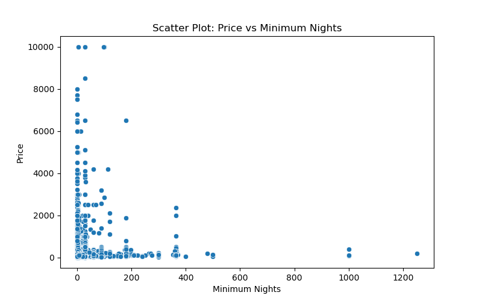
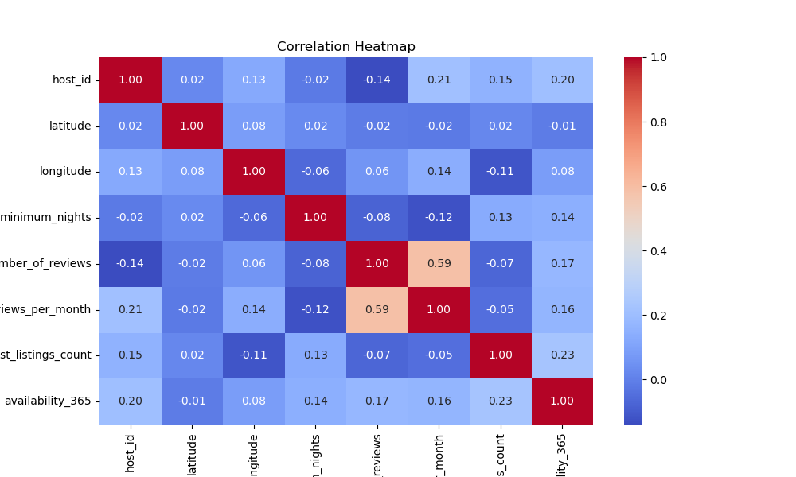

# New York City Airbnb — Listing Analysis & Price Prediction

**Business question:** What do listing characteristics tell us about Airbnb prices across New York City?

This project investigates the **AB_NYC_2019** listings dataset with data cleaning, exploratory visualizations, and a Random Forest regression workflow.

## Project at a glance

| Component | Details |
| --- | --- |
| Dataset | [AB_NYC_2019.csv](data/AB_NYC_2019.csv) — 48,895 rows, 16 original columns |
| Notebook | [Analysis and modeling](notebook/AB_NYC_2019.ipynb) |
| Charts | [graphs_output](graphs_output/) |
| Approach | EDA, preprocessing pipeline, Random Forest regression, GridSearchCV |

## Questions explored

- How are listing prices distributed?
- How do price and minimum-night requirements relate?
- Which numeric variables show correlations?
- How can listing attributes be used for predictive modeling?

## Analysis and modeling workflow

1. Load the data and inspect its columns, types, and missing values.
2. Remove selected columns such as listing ID and name fields from the modeling data.
3. Fill missing values in `reviews_per_month` and prepare remaining predictors.
4. Split data into training and test sets.
5. Use scikit-learn preprocessing components (`SimpleImputer`, `OneHotEncoder`, `StandardScaler`, `ColumnTransformer`) with **RandomForestRegressor**.
6. Examine evaluation metrics such as **R²** and **MSE** and tune hyperparameters using `GridSearchCV`.
7. Visualize distributions, scatterplots and a correlation heatmap.

## Selected visuals

| Distribution of prices | Minimum nights vs. price |
| --- | --- |
|  |  |

## Observations

- Prices are strongly right-skewed, with a relatively small number of high-price listings.
- No single numeric attribute fully explains price variation; room type and location may also matter.
- Extreme values in price and minimum nights deserve careful treatment when interpreting and modeling the data.

These are exploratory findings rather than claims of causal effects.

## Reproducing the project

Start with the [notebook](notebook/AB_NYC_2019.ipynb) and [CSV](data/AB_NYC_2019.csv). Install Python, Pandas, NumPy, scikit-learn, Matplotlib and Seaborn.

**Path note:** the notebook currently includes `pd.read_csv("data/AB_NYC_2019.csv")`. Run it from the repository root or adjust the data path to match the working directory.

The original README is stored at [README.md/README.md](README.md/README.md). Its data path is a placeholder; the correct file is linked above.

## Limitations

- The dataset is from 2019; its prices do not describe today's market.
- Outliers and skewed prices may influence regression performance.
- No model score is quoted here without verifying the evaluation outputs.

---

**Author:** Aqsa Mansoor · [GitHub profile](https://github.com/AqsaMansoor32)

> The repository currently contains a folder called `README.md`, so a root `README.md` cannot be added without first migrating the folder. This overview preserves the original content while that structure is reviewed.
